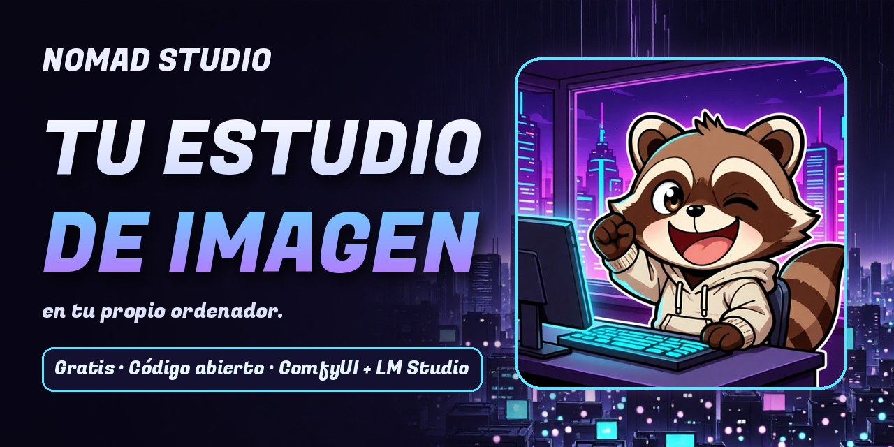

# Nomad Studio



**[Descargar](https://nomadstudio.app/download)** · **[Videotutoriales](https://nomadstudio.app/tutorials)** · **[Web](https://nomadstudio.app)** · **[Packs](https://ko-fi.com/nomadstudio/shop)**

**Un estudio creativo de imagen en tu propio ordenador.** Crea, retoca y organiza imágenes con [ComfyUI](https://github.com/comfyanonymous/ComfyUI) como motor de imagen y [LM Studio](https://lmstudio.ai/) para escribir prompts y describir imágenes. Tus imágenes se quedan en tu carpeta. Sin créditos ni nube.

[English](README.md) · Español · [中文](README_ZH.md) · [한국어](README_KO.md) — la aplicación está disponible en inglés, español, chino y coreano.

## Descarga

Las versiones portables para **Windows** y **Linux** están en la [página de descarga](https://nomadstudio.app/download) y en [Releases](https://github.com/nomadstudioapp/NomadStudio/releases/latest), y una experimental y sin firmar para **macOS** (Apple Silicon). Descomprime y arranca: Python y todas las librerías van dentro. El asistente de configuración te instala ComfyUI, y LM Studio, que te recomendamos. Unos vídeos cortos te guían en la primera instalación, el siguiente arranque y las actualizaciones.

## Qué es

- **Create, Refine, Mix, Session y Build.** Empieza con unas palabras, una foto o una plantilla; retoca con tus propias palabras; junta varias imágenes en una; encadena flows en un proyecto; ten a mano tus personajes, lugares y estilos.
- **Un núcleo vacío que instala flows como paquetes.** Motores, flows, template packs y complementos llegan como paquetes ZIP ([docs/PACKAGE_FORMAT.md](docs/PACKAGE_FORMAT.md)).
- **Perfiles y Sessions.** Cada perfil tiene sus imágenes, historial y Sessions; una Vanish Session no guarda nada.
- **Asistente de configuración.** En el primer arranque comprueba ComfyUI y LM Studio, detecta qué ficheros de motores tienes, instala lo que falta y recomienda modelos de lenguaje ([docs/SETUP_WIZARD.md](docs/SETUP_WIZARD.md)).
- **Copias de seguridad y reset** desde Ajustes.
- **Servidores compartidos.** Varias instalaciones de Nomad Studio pueden usar el mismo ComfyUI y LM Studio de tu red; se esperan entre ellas en vez de pelearse por la GPU.
- **Servidor MCP** para que los agentes de IA creen y retoquen imágenes — cómo conectarlo a Claude Desktop, ChatGPT y Bionic: [docs/MCP_SETUP_ES.md](docs/MCP_SETUP_ES.md).

## Requisitos

- Windows o Linux; macOS (Apple Silicon) en fase experimental
- [ComfyUI](https://github.com/comfyanonymous/ComfyUI) en marcha (en local o en otro equipo de tu red) — el asistente de configuración puede instalarlo
- [LM Studio](https://lmstudio.ai/) — recomendado, para ayuda con prompts, chat y descripción de imágenes
- Se recomienda una GPU con 8 GB de memoria de vídeo o más; los ejemplos se hicieron con una RTX 4060 Ti de 16 GB
- Python 3.13 solo si lo ejecutas desde el código

## Ejecutar desde el código

```bash
python -m venv .venv
.venv/Scripts/pip install -r requirements.lock   # Windows
.venv/Scripts/python app.py
# .venv/bin/pip install -r requirements.lock     # macOS / Linux
# .venv/bin/python app.py
```

Abre http://localhost:5123 — el asistente de configuración arranca la primera vez. Para usar otro puerto, define antes `PORT`: `PORT=5124 python app.py` en Linux y macOS, `$env:PORT=5124; python app.py` en PowerShell de Windows.

Las versiones portables y las actualizaciones desde la app se describen en [docs/APP_UPDATES.md](docs/APP_UPDATES.md).

## Licencia

Nomad Studio es software libre con licencia [GNU General Public License v3.0 o posterior](LICENSE). Las imágenes que generas son tuyas; los packs y los modelos de IA tienen sus propias licencias. Detalles en [LICENSING.md](LICENSING.md#español).

Si Nomad Studio te resulta útil, una ⭐ en GitHub ayuda a que otras personas lo encuentren.
