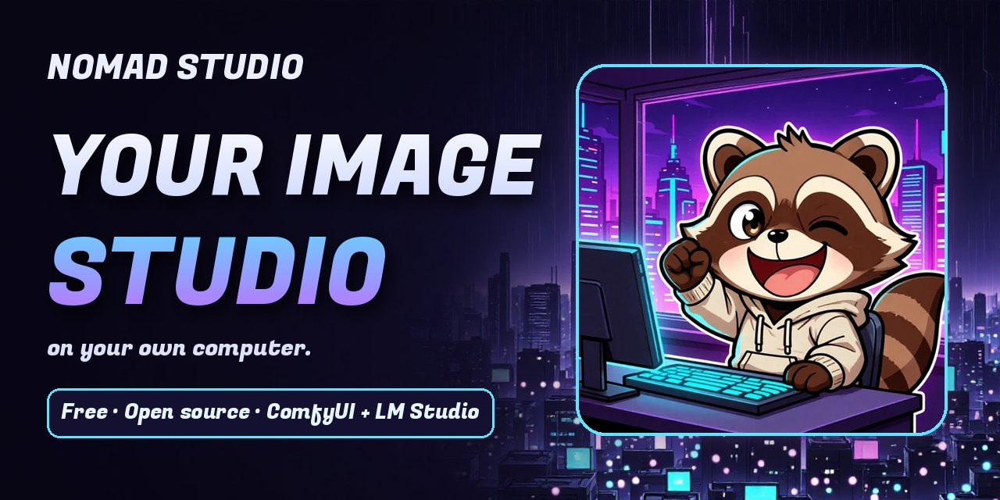

# Nomad Studio



**[下载](https://nomadstudio.app/download)** · **[视频教程](https://nomadstudio.app/tutorials)** · **[官网](https://nomadstudio.app)** · **[Packs](https://ko-fi.com/nomadstudio/shop)**

**在你自己的电脑上运行的创意图像工作室。** 以 [ComfyUI](https://github.com/comfyanonymous/ComfyUI) 作为图像引擎，用 [LM Studio](https://lmstudio.ai/) 撰写提示词和描述图像，来创建、修饰和整理图像。你的图像保存在你自己的文件夹里。没有点数，不依赖云端。

[English](README.md) · [Español](README_ES.md) · 中文 · [한국어](README_KO.md) — 应用本身支持英语、西班牙语、中文和韩语。

## 下载

**Windows** 和 **Linux** 的便携版在[下载页面](https://nomadstudio.app/download)和 [Releases](https://github.com/nomadstudioapp/NomadStudio/releases/latest) 中提供；另有面向 **macOS**（Apple Silicon）的实验性版本，未签名。解压即可运行：Python 和所有依赖库都已内置。设置向导会为你安装 ComfyUI，以及我们推荐的 LM Studio。简短的视频指南会带你完成首次安装、下次启动和更新。

## 它是什么

- **Create、Refine、Mix、Session 和 Build。** 从几个词、一张照片或一个模板开始；用你自己的话来修改；把几张图片合成一张；在一个项目中串联多个 flow；随时调用你的角色、场景和风格。
- **一个空的核心，flow 以包的形式安装。** 引擎、flow、模板包和扩展都以 ZIP 包的形式提供（[docs/PACKAGE_FORMAT.md](docs/PACKAGE_FORMAT.md)）。
- **配置文件和 Session。** 每个配置文件都有自己的图像、历史记录和 Session；Vanish Session 不保存任何内容。
- **设置向导。** 首次运行时检查 ComfyUI 和 LM Studio，识别你已有的引擎文件，安装缺少的部分，并推荐语言模型（[docs/SETUP_WIZARD.md](docs/SETUP_WIZARD.md)）。
- **备份和重置**，在设置中进行。
- **共享服务器。** 多个 Nomad Studio 可以使用你网络中同一个 ComfyUI 和 LM Studio；它们会相互等待，而不是争抢 GPU。
- **MCP 服务器**，让 AI 智能体创建和修饰图像 — 如何连接 Claude Desktop、ChatGPT 和 Bionic：[docs/MCP_SETUP_ZH.md](docs/MCP_SETUP_ZH.md)。

## 系统要求

- Windows 或 Linux；macOS（Apple Silicon）为实验性支持
- 正在运行的 [ComfyUI](https://github.com/comfyanonymous/ComfyUI)（本机或你网络中的另一台电脑）— 设置向导可以帮你安装
- [LM Studio](https://lmstudio.ai/) — 推荐，用于提示词辅助、聊天和图像描述
- 建议使用 8 GB 或以上显存的 GPU；示例图像是在 16 GB 的 RTX 4060 Ti 上制作的
- 仅从源码运行时需要 Python 3.13

## 从源码运行

```bash
python -m venv .venv
.venv/Scripts/pip install -r requirements.lock   # Windows
# .venv/bin/pip install -r requirements.lock     # macOS / Linux
python app.py
```

打开 http://localhost:5123 — 首次运行时会启动设置向导。用 `PORT=5124 python app.py` 可以换一个端口。

便携版和应用内更新的说明见 [docs/APP_UPDATES.md](docs/APP_UPDATES.md)。

## 许可证

Nomad Studio 是自由软件，采用 [GNU 通用公共许可证 v3.0 或更高版本](LICENSE)。你生成的图像归你所有；包和 AI 模型有各自的许可证。详情见 [LICENSING.md](LICENSING.md#中文)。

如果 Nomad Studio 对你有用，在 GitHub 上点一个 ⭐ 能帮助更多人发现它。
